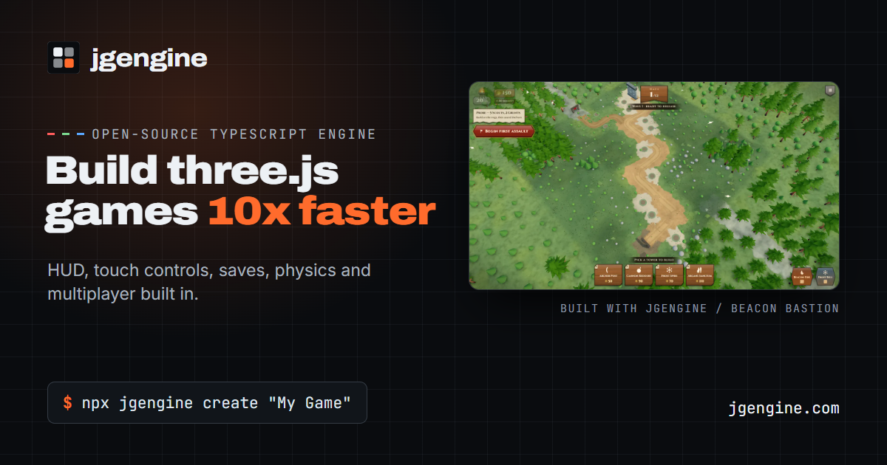

<p align="center">
  
</p>

# jgengine

**An open-source TypeScript game engine made to be built on by coding agents.** You tell an agent
*"Make a game that … with jgengine"*. The engine gives it game parts on three.js, skills that
explain them, and tools to screenshot and play what it built. Ten games are built on it in
[`games/`](games), and you can play them at [jgengine.com](https://jgengine.com).

npm: `jgengine` (the CLI) and `@jgengine/*` (the packages) · Apache-2.0 · not related to automotive "JG Engines".

## Five minutes

**Play the games in this repo** (needs [Bun](https://bun.sh)):

```sh
git clone https://github.com/Noisemaker111/jgengine && cd jgengine
bun run agent:bootstrap        # install, link workspaces, prepare generated files
bun run dev:site               # jgengine.com locally; every game plays at /games/<id>
```

One game on its own: `bun run games:provision <id>` (links its asset packs), then
`bun --cwd=games/<id> run dev`. Deepward needs no assets; LLMville also needs a local Convex backend.

**Make your own game.** Say this to Claude Code, Codex, Cursor or any agent that runs commands:

```text
Make a game that is a tower defense on two mountain roads, with jgengine
```

Or scaffold it yourself. The game is its own project on the npm packages. Don't clone this repo
to make a game.

```sh
npx jgengine create "Tide Runner"   # --template 3d (default) | 2d | builder
cd Tide-Runner && bun install && bun dev
```

You get a walkable 3D world with a HUD, the scene editor (F2+E in the browser) and the agent
skills, installed in the project.

**Use one part in a game you already have.** Model files have no dependencies, so you import the
one you need by its path:

```ts
import { changeMeter, createMeter, tickMeter } from "@jgengine/core/stats/statPool";

let stamina = createMeter({ max: 100 });
stamina = changeMeter(stamina, -30).meter; // sprinting
stamina = tickMeter(stamina, { regen: 10, regenDelay: 1 }, 2).meter; // 90 after two seconds
```

A whole game runs on `createGameContext` (`@jgengine/core/runtime/gameContext`). [jgengine.com/adopt](https://jgengine.com/adopt)
shows health, XP, saves and the minimap added to an existing game.

## What's different

- **Built for agents.** Skills ship inside the npm packages, so an agent finds them in
  `node_modules`. The CLI answers its questions: `jgengine find <words>` (where does this live),
  `has <feature>` (does the engine do it), `recipe <name>` (a wired snippet), and `shoot` and `drive`
  (screenshot the game and play it with keys).
- **The games live with the engine.** The ten games in `games/` run engine source from the same
  commit, so a change that breaks a game gets fixed in the same pull request.
- **Parts, not features.** A boss fight or a supply drop isn't an engine feature. The game combines
  it from eleven small parts ([below](#the-parts)), and any part can be turned off, swapped or
  retuned.
- **Layers a server can trust.** Model, UI and three.js code sit side by side in one folder, and
  the file suffix says which is which. Servers import only model code.
- **Measured, not claimed.** A frame gate, a load-time guard, A/B runs with a 99% interval, and
  experiments that didn't ship because they lost the measurement.

## Decisions, and why

Each decision with its date, reason and numbers. The site tells them as a timeline at
[jgengine.com/#decisions](https://jgengine.com/#decisions).

| Date | Decision | Why | Source |
| --- | --- | --- | --- |
| 2026-07-11 | One sentence to an agent is the human interface; skills ship in the npm tarballs | Outside agents were cloning this repo and copying game content | #435, #697 |
| 2026-07-16 | AGPL-3.0 → Apache-2.0 + NOTICE | Paid, closed-source games can ship; the NOTICE keeps the credit | #855 |
| 2026-09-25 | `docs/`, plans and logs deleted; CI fails if they return | They go stale, and every agent session re-reads them | #1851 |
| 2026-10-25 | Games moved back into `games/`, on engine source from the same commit | Breakage is fixed in the same PR; no version pins or cross-repo bumps | 649fb4013 |
| 2026-10-29 | Every feature built from eleven parts | The engine had ~16 meters, 15 tier lists and 25 stage lists inside one-game features | #2817 |
| 2026-10-31 | Frame gate: p95 ≤ 16.7 ms on an RTX 3070 at 1600×900; 360 fps (2.78 ms) as the target | Replaced per-game draw, triangle and node ceilings with the frame time itself | 0868847c4, #3028 |
| 2026-11-07 | Native Rust renderer measured; **not shipped** | Harbor Heat went from 73 fps to 182–272 native and 283 as wasm + WebGPU in Chrome. Deepward gained nothing because it waits on the GPU. The slow part was the WebGL path, not the browser | [`native/README.md`](native/README.md), #3041 |
| 2026-11-08 | WebGPU backend as a **preview**; WebGL stays the default | It draws the same image but wins on no game yet (0.8–1.2× WebGL's frame time) | #3067, #3072 |
| 2026-11-10 | React Three Fiber, drei and React removed; the engine's own JSX runtime and frame loop | React + R3F were 33.6% of Deepward's main thread and did untimed work in 8 of 9 games. The switch itself has not been timed yet | #3099, #3108, #3019 |
| 2026-11-11 | Every game's UI drawn by Rune | The CSS-to-Rune mirror was deleted. Recorded cost: the UI wasm is 10.3 MB (4.9 MB gzipped) | #3117–#3134, #3137 |

## How it runs

- **3D** is plain three.js (JavaScript, not compiled to wasm) on a frame loop the engine owns.
  WebGL is the default. The WebGPU preview (Graphics > Renderer, or `?renderer=webgpu`) gives
  three's unchanged WebGL renderer a WebGL-shaped context that submits through WebGPU. Shaders
  are translated from GLSL to WGSL by naga compiled to wasm (`packages/core/src/webgpu`).
- **UI** is JSX on the engine's own runtime (`@jgengine/core/ui/jsx`), never React. Games that set
  `uiRenderer: "rune"` (every game in `games/`) draw it with Rune: a vendored Rust UI library
  (`native/vendor/rune`, wrapped by `native/crates/jg-ui`) compiled to wasm and drawn on the
  game canvas. Games without it get the DOM host. A React, Next or TanStack page embeds a game
  with `mountGamePlayer` (`@jgengine/shell/mountGamePlayer`); see `examples/next-host` and
  `examples/tanstack-host`.
- **Multiplayer** is one protocol over swappable transports: WebSocket, socket.io, WebRTC P2P,
  LAN and Convex, with Node hosting and Postgres persistence.
- **Ships to** the browser, a Windows `.exe` (`npx jgengine desktop`, Tauri), and npm.

### Layering

Each engine feature is one folder in `packages/core/src/<feature>/` holding all its layers, named
by file: a plain `name.ts` is **model** (no UI runtime, no three.js), `name.view.tsx` is **view**
(UI on the engine runtime, no three.js) and `name.draw.tsx` is **draw** (three.js).
`packages/ui` is all view and `packages/shell` all draw. `bun run check layers` enforces this
from the imports in under a second, so a server or worker importing model files never loads the
UI runtime or three.js. `ws` and `sql` import only `core` model files; `shell` is the only package
that renders.

### The parts

Most game features are made of these eleven parts (`@jgengine/core/parts` re-exports their
model layer) plus the engine's entities, containers and world. Each has one home. A feature that
needs one uses that home and doesn't write its own.

| Part | What it is | Examples | Home |
| --- | --- | --- | --- |
| Meter | a number with a range that drains, fills or regenerates, and takes doses | health, hunger, ammo, shield; a meal or potion | `stats/statPool.ts`, `stats/vitals.ts`, `stats/doseTable.ts` |
| Ladder | ordered steps over a number | rarity, tiers, ranks, levels, wanted stars | `threshold/thresholds.ts` |
| Phases | named states one after another, by time or event | growth stages, boss phases, day parts | `time/stateSchedule.ts` |
| Schedule | something happens at a pace from a start time | waves, supply drops, weather, respawns | `time/pacedSchedule.ts` |
| Slots | named spots that each hold one thing and refill | crates, resource nodes, boss spawns | `time/refillSlots.ts` |
| Placement | where something appears | spawn points, scatter, drop zones | `world/spatialSample.ts`, `game/spawnPoints.ts` |
| Table | a weighted choice the game fills | loot per rarity, which enemy | `random/pick.ts` |
| Requirement | a condition over facts the game names | level gates, keys, unlocks | `rules/predicate.ts` |
| Modifiers | stacked add, multiply, override and clamp | buffs, gear stats, difficulty | `progression/statGraph.ts` |
| Inheritance | a child's values from its parents with variation | breeding, crossing plants | `inheritance/inheritance.ts` |
| Motion track | a thing follows a path over time and arrives | a falling crate, a thrown item, a door | `movement/motionTrack.ts` |

A supply drop is Schedule (when), Placement (where), Ladder (rarity), Requirement (who may open
it), Table (loot), Motion track (the fall) and Slots (one crate per site), so a game writes
`spawnSupplyDrop(x, y, "purple")` itself in a few lines. Some older features still hold private
copies of these parts; `bun run part-stats --worklist` lists them, and new code never adds one.

## Packages

The lockstep set `@jgengine/{core,rapier,ui,ws,node,sql,convex,shell,assets,editor,navbake}` is
versioned together; package manifests own the versions. The CLI `jgengine` and `@jgengine/github`
have their own version lines.

| Package | What it is |
| --- | --- |
| [`@jgengine/core`](packages/core) | The engine: feature folders with model, view and draw files, `GameContext`, entities, commands, combat, HUD, saves, inventory, world. No dependencies; three.js is an optional peer for draw files. Import by deep path. |
| [`@jgengine/ui`](packages/ui) | Game UI on the engine's JSX runtime: `GameProvider`, hooks, primitives. No React inside. Published as `@jgengine/react` until 0.57.0; that name is deprecated: replace it with `@jgengine/ui` in imports and `"react"` with `"ui"` in `jgengine.json`'s `engine` list. |
| [`@jgengine/shell`](packages/shell) | The game player: three.js canvas on the engine frame loop, cameras, input, HUD mounting. You supply a `GameRegistry`. |
| [`@jgengine/rapier`](packages/rapier) | Rapier physics backend: capsules, shapecasts, CCD, joints. The built-in solver needs none of it. |
| [`@jgengine/ws`](packages/ws) | Browser-safe multiplayer over a pluggable pipe (WebSocket, socket.io, WebRTC, loopback), with an authoritative host and router. |
| [`@jgengine/node`](packages/node) | Node hosting: WebSocket server, socket.io attach, memory and file persistence. |
| [`@jgengine/sql`](packages/sql) | `HostPersistence` on Postgres through a structural pool (no hard `pg` dependency). |
| [`@jgengine/convex`](packages/convex) | Convex game and presence transports. |
| [`@jgengine/navbake`](packages/navbake) | Deterministic navigation-mesh baking. |
| [`@jgengine/editor`](packages/editor) | Scene, world and asset editor. Loaded lazily by the runner; standalone with `npx jgengine editor`; agent bridge with `jgengine editor-mcp`. |
| [`@jgengine/assets`](packages/assets) | License-checked index of CC0 3D models with a pull CLI (the index, not the model files). |
| [`@jgengine/github`](packages/github) | GitHub contribution data for games that show a real profile. |
| [`jgengine`](packages/jgengine) | The agent CLI: `create`, `sync`, `find`, `has`, `recipe`, `desktop`, `doctor`, `skills`, `assets`, `editor`, `editor-mcp`, `shoot`, `drive` and more (`npx jgengine help`). |

## Develop the engine

Agents working here start with [AGENTS.md](AGENTS.md). Run from the repo root:

```sh
bun run agent:bootstrap        # setup; @jgengine/* resolves to package source, no build needed
bun run test <path>            # tests; no path runs all of them
bun test games                 # every game's tests and scripts
bun run check types            # type-check
bun run verify:fast            # the checks the branch diff reaches, in seconds
bun run gen                    # regenerate committed derived files after public API changes
bun run find <words>           # which package and folder owns a concept
bun run lane:close -m "<what>" # gate, commit, push and merge into beta
bun run perf <game>            # frame scorecard (p50/p95/p99, main thread, GC); --help for gate, ab, fps-gap, server
bun run shoot <game>           # a real screenshot of a game; drive plays it
bun run games:provision        # link the asset packs the games use
bun run build                  # only for packing or the Node CLI
```

Windows: if `bun` isn't recognised after installing, add `%USERPROFILE%\.bun\bin` to PATH and
reopen the terminal.

**Public exports.** Every package exports `"./*"`, so each built file is an importable subpath.
`scripts/export-manifest.json` records that surface; `bun run gen` regenerates it and
`scripts/exportManifest.test.ts` fails when it drifts. `scripts/tarballInstall.test.ts` packs each
package and imports it from a clean folder (after `bun run build`).

**Releases.** Publishing is a milestone, not a step after each change. `bun run release` cuts the
changelog and bumps the lockstep versions; `publish.yml` publishes what npm doesn't have yet
(`next` for a prerelease, `latest` for a release). Games here never wait on a release.

**The website** ([`apps/web`](apps/web)) is drawn with the engine's own JSX runtime, prerendered to
static pages and deployed to Cloudflare Workers. Its agent pages are rendered from
`.claude/skills/`, and `/play` bundles the game runner from `apps/dev`. See
[`apps/web/README.md`](apps/web/README.md).

## Credits

JGengine's procedural buildings, water, rain and snow renderers were shaped from
**[achrefelouafi](https://github.com/achrefelouafi)**'s MIT-licensed Three.js reference projects.
Rune is by [Anomaly](https://github.com/anomalyco/rune) (MIT). See [CREDITS.md](CREDITS.md) for
the full list.

## License

[Apache-2.0](LICENSE) with a [`NOTICE`](NOTICE) file. Commercial and closed-source games are fine;
keep the NOTICE in what you ship (Apache §4(d)). Third-party code and assets keep their own
licenses. FAQ: [LICENSING.md](LICENSING.md).
