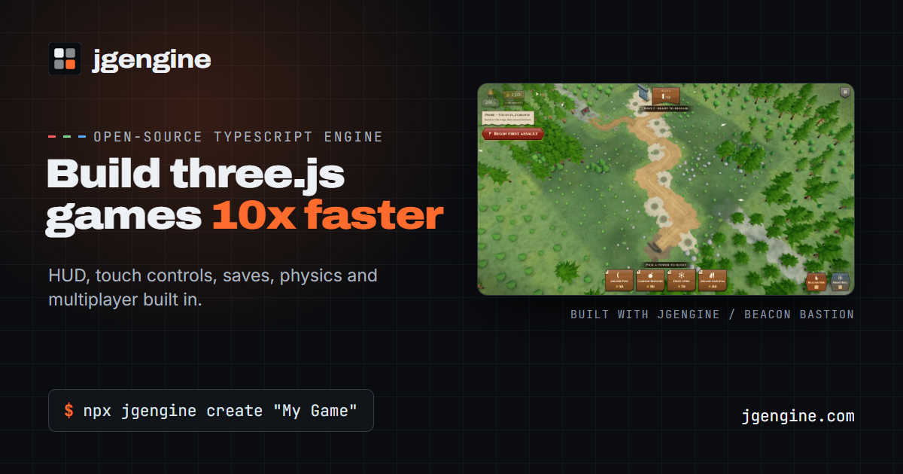

<p align="center">
  
</p>

# jgengine

**pure-TypeScript game framework SDK** — npm `jgengine` / `@jgengine/*` · site [jgengine.com](https://jgengine.com). The whole product surface for people is one sentence said to a coding agent: *Make a game that … with jgengine*. Agent skills ship inside every package tarball (`node_modules/@jgengine/<pkg>/skills/`).

> Not related to automotive “JG Engines” / “JG Engine Dynamics”. This is software — a pure-TypeScript **framework** (entity stores, commands, catalogs, multiplayer seams, R3F shell), not an ECS and not a general-purpose 3D engine.

`@jgengine/core` has no React, no renderer, and no backend dependency — adapters connect it to React, Convex, WebSockets, Node hosting, and Postgres (socket.io, WebRTC P2P, and LAN share the same protocol). Domains are opt-in at runtime via `defineGame({ features })`; the monorepo ships a wide primitive set. Coding agents build whole games on it from that one sentence: skills provide design playbooks, intake, focused API guidance, and verification, and route selectively so agents do not load every domain by default.

## Build the framework through games

Every game interaction should compose shared JGengine capabilities. Adopt an existing
API first; when reusable behavior is missing or broken, improve its upstream package
with a real game adopter and remove the superseded local implementation. Games own
their rules, stories, items, assets, authored worlds and presentation. The engine owns
the common machinery that makes those choices work. Shared behavior must preserve
different art directions and gameplay, not impose a common game or asset kit.

A JGengine game can be anything, so the engine is small general parts that a game
combines in a few lines into its own features. A "supply drop", "breeding" or "boss fight" is
the game's combination, never one closed engine feature, and every part can be switched off,
swapped or retuned.

### The parts

Most game features are made of these eleven parts plus the engine's entities, containers and
world. Each has one home; a feature that needs one uses that home and never writes its own.

| Part | What it is | Examples it covers | Home |
| --- | --- | --- | --- |
| Meter | a number with a range that drains, fills or regenerates | health, hunger, ammo, combo, torpor, heat, stamina | `stats/statPool.ts` |
| Ladder | ordered steps over a number, named by the game | rarity, tiers, ranks, levels, mood bands, wanted stars | `threshold/thresholds.ts` |
| Phases | named states one after another, by time or by event | growth stages, boss phases, day parts, a match's rounds | `time/stateSchedule.ts` |
| Schedule | something happens at a pace from a start time | waves, supply drops, weather, events, respawns | planned, `time/` |
| Slots | named spots that each hold one thing, ready again a while after it is gone | supply crates, resource nodes, herd dens, boss spawns | `time/refillSlots.ts` |
| Placement | where something appears | spawn points, scatter, drop zones, safe spots | `world/spatialSample.ts`, `game/spawnPoints.ts` |
| Table | a weighted choice the game fills | loot per rarity, which enemy, which mutation | `random/pick.ts` |
| Requirement | a condition over facts the game names | level gates, keys, quest prerequisites, unlocks | `rules/predicate.ts` |
| Modifiers | stacked add, multiply, override and clamp on a value | buffs, gear stats, difficulty, upgrades, imprinting | `progression/statGraph.ts` |
| Inheritance | a child's values from its parents with variation | breeding, crossing plants, procedural offspring | `inheritance/inheritance.ts` |
| Motion track | a thing follows a path over time and arrives | a drop falling, a thrown item, a door, a cutscene move | planned, `movement/` |

A supply drop is a Schedule (when), Placement (where), Ladder (rarity), Requirement (who may
open which rarity), Table (loot per rarity) and Motion track (the fall and landing), with each
site's crate held in Slots (one per site, refilled a while after it goes), so a game
writes `spawnSupplyDrop(x, y, "purple")` itself in a few lines. Simple dog breeding is
Inheritance plus a Phases list for puppy to adult; it needs none of the rest. Much of today's
engine still has its own copies of these parts inside one-game features; they are being
replaced by the parts, and new code never adds another copy.

The games in [`games/`](games) are workspaces of this repo and run engine source from the
same commit, so an engine change and the games it breaks are fixed in one PR. Outside users get
engine changes as npm versions; a breaking change carries a semver bump and a migration note.
Publishing is a milestone for outside users, not a step after each change. `bun run release` cuts the changelog and bumps the lockstep versions, that
commit fast-forwards `main`, and `publish.yml` publishes the versions npm does not
already have — `next` for a prerelease, `latest` for a release — after
`bun run check release-set` proves the publish order matches the manifests. The development and
adoption rules live in [AGENTS.md](AGENTS.md#game-changes-improve-the-framework).

## Packages

**Versions:** the lockstep game SDK set is `@jgengine/{core,rapier,react,ws,node,sql,convex,shell,assets,editor,navbake}` - bump together. Package manifests own the current versions. Separate cadences: CLI package `jgengine` and `@jgengine/github` (may lag; not part of that lockstep set).

| Package | What it is |
| --- | --- |
| [`@jgengine/core`](packages/core) | The engine's feature folders: `GameContext`, entity/object stores, commands, combat, HUD, save, inventory, multiplayer contracts, world features. Model files have zero dependencies; a feature's `*.view` (React) and `*.draw` (three.js) files sit beside them and need the optional peers. Import by deep path. |
| [`@jgengine/rapier`](packages/rapier) | Rapier physics adapter for `PhysicsBackend`, providing native capsules, shapecasts, rotation, CCD, and joints. |
| [`@jgengine/react`](packages/react) | React UI layer: `GameProvider`, hooks, headless primitives. |
| [`@jgengine/ws`](packages/ws) | Browser-safe game backend over a pluggable transport pipe (WebSocket/socket.io/WebRTC/loopback): protocol codec, `createWsBackend`, `createHttpReads`, a browser-safe authoritative host + router, and WebRTC P2P sessions. |
| [`@jgengine/node`](packages/node) | Node bindings over `@jgengine/ws`'s host: WebSocket server, socket.io server attach, memory/file persistence, save-cadence flush. |
| [`@jgengine/sql`](packages/sql) | `HostPersistence` on Postgres through a structural pool interface (no hard `pg` dependency). |
| [`@jgengine/navbake`](packages/navbake) | Deterministic indexed-geometry navigation-mesh baking. |
| [`@jgengine/convex`](packages/convex) | Convex adapters: game transport, presence transport. |
| [`@jgengine/shell`](packages/shell) | Game player shell: R3F canvas, orbit camera, input tracking, HUD mounting, `GameUiPreview`, demo game. You supply a `GameRegistry`. |
| [`@jgengine/assets`](packages/assets) | Self-generating, license-verified index of CC0 3D models: ships the typed index + pull CLI, not the GLB bytes. |
| [`@jgengine/editor`](packages/editor) | Scene/world/asset editor, loaded lazily by the runner; runs standalone on any folder via `npx jgengine editor` or the desktop app (`StandaloneEditor`); agent bridge via `jgengine editor-mcp`. |
| [`@jgengine/github`](packages/github) | GitHub data source: contribution calendar fetch for games that render real profile data. Zero dependencies. Own version line. |
| [`jgengine`](packages/jgengine) | Agent-side CLI (`npx jgengine`) — create, skills, doctor, desktop. Own version line. **People** tell an agent *Make a game that … with jgengine*. |

## Install

```sh
bun add @jgengine/core
# plus the adapters you need:
bun add @jgengine/react @jgengine/shell @jgengine/ws
bun add @jgengine/node @jgengine/sql   # server host
bun add @jgengine/convex               # Convex backend
```

Modules are imported by path, e.g.:

```ts
import { createGameContext } from "@jgengine/core/runtime/gameContext";
import { createWsBackend } from "@jgengine/ws/createWsBackend";
```

## How people build games (outside this monorepo)

**One interface.** Open any coding agent and say:

```text
Make a game that ... with jgengine
```

Examples: *Make a game that is Mario Party with goo characters, with jgengine* · *Make a game that is a first-person voxel miner, with jgengine*.

That is the whole product surface for humans. No install checklist, no “run skills first,” no required CLI.

Under the hood the agent uses `npx jgengine` (create, skills, doctor) and the skills in [`.claude/skills/`](.claude/skills) — an intake router, game/level design playbooks, and focused API domains, staged into published tarballs at `skills/` so they travel with `node_modules`. Power users may call the CLI themselves; that is optional, not the entry.

The game the agent builds is **its own project in its own repo/directory**, on the published npm packages. Agents must **never clone this monorepo** to build a game, and must **never copy code, assets, or content from the probe games** in [`Noisemaker111/JGengine-games`](https://github.com/Noisemaker111/JGengine-games) — those are private probe games (some recreate well-known commercial titles for engine-gap probing), not templates, and their content is not licensed for reuse. `npx jgengine create` is the only starting point.

## Website — [jgengine.com](https://jgengine.com)

[`apps/web`](apps/web) is a TanStack Start app: landing for humans (the prompt) and skill/API pages for agents. Skill pages are **rendered from `.claude/skills/jgengine-*`**, with no separate content to maintain.

It deploys to Cloudflare Workers through the official Cloudflare Vite plugin. Because the site is built from `.claude/skills/` and `packages/`, **shipping an engine or skill change redeploys the site with it** — the deploy of the engine is the deploy of the website. Setup in [`apps/web/README.md`](apps/web/README.md).

The games in [`games/`](games) are also playable on jgengine.com at `/games/<id>` — the page embeds the `apps/dev` runner, which the site bundles as a static build. Root `bun dev` serves that same runner build locally (content-hash cached, rebuilt when game or engine sources change), so the games are playable at `/games/<id>`. To play one standalone, run `bun --cwd=games/<id> run dev`.

## Layering

Each engine feature is one folder in `core` holding all its layers, named by file: a plain `name.ts` is **model** (no React, no three.js, no view or draw file), `name.view.tsx` is **view** (React UI; no three.js, no draw file), `name.draw.tsx` is **draw** (three.js / react-three-fiber). `react` is all view and `shell` all draw. `bun run check layers` enforces this from the imports in under a second, so a server or worker importing model files never loads React or three.js. `core`, `react` and `shell` import each other through these files, so `scripts/build-engine.ts` compiles them as one program and writes each package's `dist/`. `ws` and `sql` import only `core` model files. `react` adds React, `convex` adds Convex + React, `node` adds Node builtins + `ws`, `shell` adds React + three.js (the only package that renders). `editor` sits on top of `shell`/`react`/`core`; `assets` and `github` are standalone data packages games opt into.

## Development

```sh
bun install
bun run check types  # @jgengine/* resolves to package source; no build needed
bun run test
bun scripts/test-shard.ts a  # one CI test shard locally (a-i); --check counts files, --print lists them
bun scripts/type-shard.ts    # what the CI `types` job runs: check-types two stages at a time, then the tsc fan-out alone
bun run verify:fast --full         # the whole local verdict in one run: build, then check-types and every test
bun run build        # tsgo + import-extension rewrite, per package; only for pack/publish and the Node CLI
bun run gen           # regenerate every committed derived artifact, in dependency order
bun run verify:fast   # seconds: the branch diff vs origin/beta mapped to the packages, tests and quick gates it reaches
bun run lane:close    # verify:fast, land, one ci:status read, print the lane report
bun --filter="@games/*" run check-types  # type-check every game in games/ against this checkout's engine source
bun test games         # every game's tests and the games' own scripts
bun run games:provision    # link the asset packs the games reference from the shared store (games:provision <id> for one game)
bun dev              # jgengine.com locally, games playable at /games/<id>
bun run perf <game>  # 1080p walk: frame p50/p95/p99, CPU per system, GPU per pass, top objects and hitches with their cause, as a text summary and .scratch/perf/<game>.json (--compare before.json diffs, --json prints the record) (--help; --state pins the scene, --param k=v pins a spawn/seed, --set key=value prices a setting)
bun run perf live <game> # the same JSON for a game already open in a browser, ~0.3 s, fails on a budget breach
bun run perf gate    # CI gate: plays all 8 reference games and fails on draws/triangles/nodes over games/<id>/perf-budget.json (scripts/perf-budget.json when a game has none), or any program/framebuffer created after warmup (--help)
bun run perf timing    # the CPU timing gate: re-runs the benchmarks that carry wall-clock budgets (nav crowd, perception, utility, visibility, off-screen, flock, paths) and fails when one exceeds it
# one game standalone:
bun --cwd=games/harbor-heat run dev
```

Windows: if `bun` is not recognized after installing, its install directory is missing from PATH — add `%USERPROFILE%\.bun\bin` (PowerShell: `[Environment]::SetEnvironmentVariable("Path", "$env:Path;$env:USERPROFILE\.bun\bin", "User")`) and reopen the terminal.

`bun run host:fixture` builds and serves the anonymous Relay Courtyard authority fixture from a clean owned checkout: compiled frontend on `4624`, realm on `4625`, driven by normal shell commands and keyboard input. Build artifacts, logs and saves live under the repository home's `.scratch/authority-fixture/`; `--allow-dirty` labels development builds explicitly. Each `/__version` reports the revision embedded in its compiled artifact. `services.json` registers both components for `fresh-services.mjs`; reload executes the landed launcher and requires the recorded source checkout at that exact revision. This fixture does not publish packages or serve game accounts.

**Public export surface.** Every `@jgengine/*` package ships a broad `"./*"` wildcard export, so every built `dist` file is an importable subpath. `scripts/export-manifest.json` is the reviewed record of that surface — the exact set of subpaths a consumer can `import`, computed from the source files each package's `tsconfig.build.json` emits and regenerated by `bun run gen`, so rerun and commit after adding, removing or renaming public source. `scripts/exportManifest.test.ts` fails when the real subpaths drift from the manifest, so an accidental new public path (or a test fixture leaking out) is caught in review; `bun run preflight` (which `lane:close` runs first) regenerates every generated artifact before the type-checks and gates. `scripts/tarballInstall.test.ts` packs each package (`npm pack`) and imports it from a clean consumer dir with no workspace aliases — proving the published tarball resolves and that build-excluded internals (`testFixtures`, `*.test`, `testkit`) are never importable; it requires `bun run build` first (it reads `dist`).

## Credits

JGengine's procedural buildings, water, rain, and snow renderers were shaped
from **[achrefelouafi](https://github.com/achrefelouafi)**'s MIT-licensed
Three.js reference projects. See [CREDITS.md](CREDITS.md) for the full mapping —
and go star his work.

## License

[Apache-2.0](LICENSE), with a [`NOTICE`](NOTICE) attribution file. Full FAQ: [LICENSING.md](LICENSING.md).

**In short.** Apache-2.0 permits commercial and closed-source use — ship a paid game on the engine, no dual-license conversation needed. The one condition: keep the [`NOTICE`](NOTICE). Apache §4(d) requires derivative works to retain it, and it credits jgengine.com. This replaces the project's prior AGPL-3.0 copyleft. Third-party and ported code and assets keep their own licenses — see [CREDITS.md](CREDITS.md).
