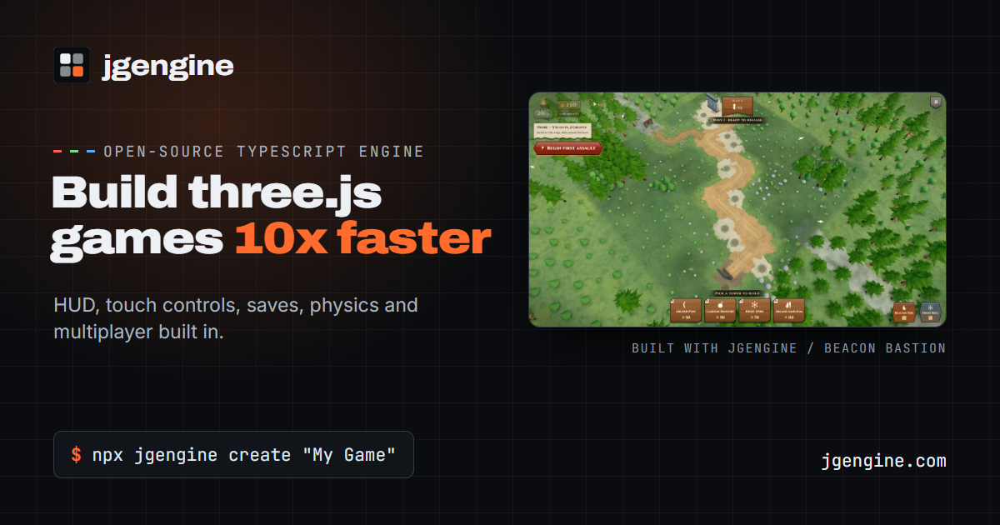
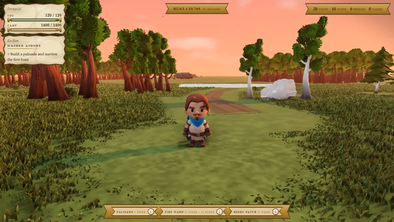
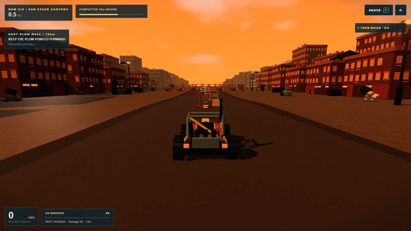
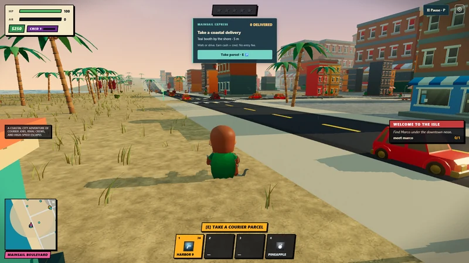
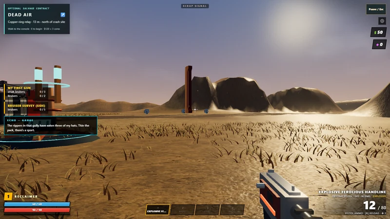
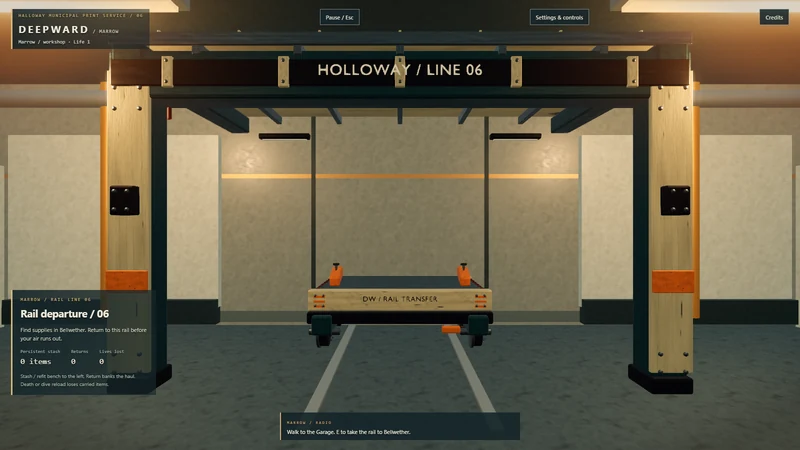
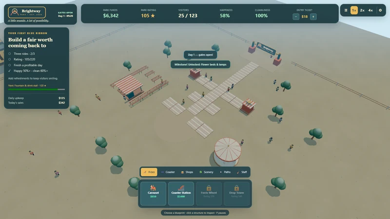
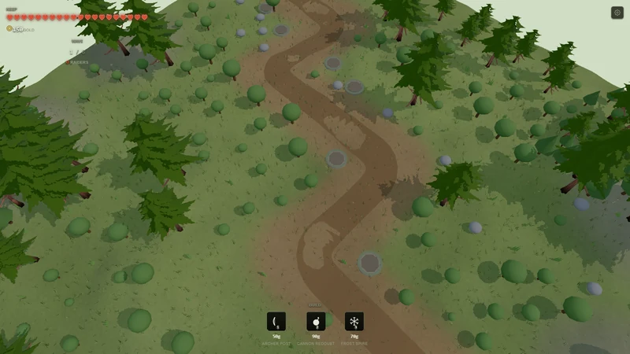
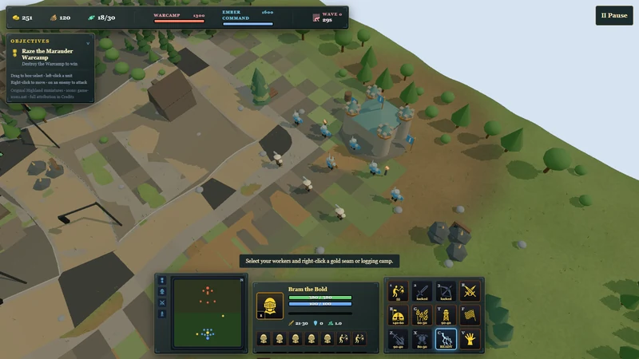
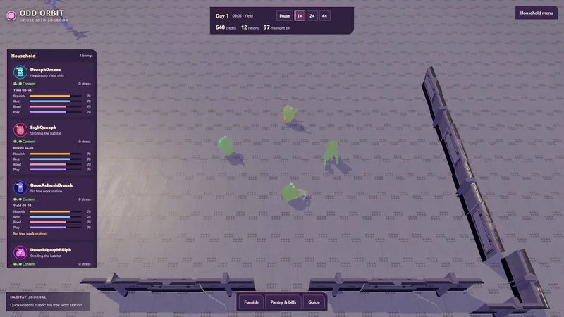

<p align="center">
  
</p>

<h1 align="center">jgengine</h1>

<p align="center">
  <b>An open-source TypeScript game engine on three.js, made for coding agents to build on.</b><br />
  Tell Claude Code, Codex or Cursor <i>"Make a game that … with jgengine"</i> and it has the parts, the docs and the tools to finish the job.
</p>

<p align="center">
  <a href="https://jgengine.com">jgengine.com</a> ·
  <a href="https://jgengine.com/games">Play the games</a> ·
  <a href="#the-api-in-four-files">The API</a> ·
  <a href="#start">Start</a> ·
  <a href="https://www.npmjs.com/package/jgengine">npm</a> ·
  Apache-2.0
</p>

<table>
  <tr>
    <td><a href="https://jgengine.com/games/fernwild"></a><br /><b>Fernwild</b> · dinosaur taming and survival</td>
    <td><a href="https://jgengine.com/games/drift-foundry"></a><br /><b>Drift Foundry</b> · physics racer</td>
    <td><a href="https://jgengine.com/games/harbor-heat"></a><br /><b>Harbor Heat</b> · coastal courier city</td>
  </tr>
  <tr>
    <td><a href="https://jgengine.com/games/scrap-signal"></a><br /><b>Scrap Signal</b> · looter-shooter</td>
    <td><a href="https://jgengine.com/games/deepward"></a><br /><b>Deepward</b> · first-person extraction</td>
    <td><a href="https://jgengine.com/games/brightway-park"></a><br /><b>Brightway Park</b> · park-builder tycoon</td>
  </tr>
  <tr>
    <td><a href="https://jgengine.com/games/beacon-bastion"></a><br /><b>Beacon Bastion</b> · tower defense</td>
    <td><a href="https://jgengine.com/games/ember-command"></a><br /><b>Ember Command</b> · command skirmish</td>
    <td><a href="https://jgengine.com/games/odd-orbit"></a><br /><b>Odd Orbit</b> · alien household sim</td>
  </tr>
</table>

Ten games run on the engine, all in [`games/`](games) on the engine source of the same commit. Play
them in the browser at [jgengine.com/games](https://jgengine.com/games).

## What makes it different

- **Game rules are plain data and plain functions.** A run, an inventory, a wave is JSON in a typed
  store slot. Rules are functions from state to state, with no engine object and no renderer. The
  same code runs in the browser, on a Node host and in `bun test`, and saves, replays and multiplayer
  snapshots carry the state without extra code.
- **Eleven parts instead of a thousand features.** A boss fight or a supply drop isn't an engine
  feature. The game builds it from [eleven small parts](#the-eleven-parts): a meter, a ladder, a
  table, a schedule… Each can be turned off, swapped or retuned, and each works on its own in a game
  that doesn't use the rest of the engine.
- **The file name says what it may import.** `name.ts` is model, `name.view.tsx` is UI, `name.draw.tsx`
  is three.js. `bun run check layers` enforces it from the imports in under a second, so a server
  that imports model files never loads UI code or three.js.
- **Agents can find, check, see and play what they build.** The skills ship inside the npm packages.
  The CLI answers an agent's questions: `jgengine find <words>` (where does this live), `has <feature>`
  (does the engine do it already), `recipe <name>` (a wired snippet), `shoot` (a real screenshot) and
  `drive` (play the game with keys and read its numbers).
- **Tested on ten real games in one repo.** No version pins between the engine and the games. A change
  that breaks one is fixed in the same pull request.
- **Measured, not claimed.** One frame budget for every game, checked by `bun run perf gate`: p95 ≤
  16.7 ms on an RTX 3070 at 1600×900. Experiments ship only when the numbers say so. A native Rust renderer went from 73 to 182–272 fps
  on one game and nothing on another, so it stayed an experiment. The full log, with dates and
  numbers, is at [jgengine.com/decisions](https://jgengine.com/decisions).

## The API in four files

A complete game: walk around, press E to gather, energy drains over time, and ranks go up. These
four files are compiled against the engine on every commit (`apps/web/src/snippets/tour-*`), so
they're the real API.

**1. Rules** are pure functions over plain data, built from the engine's parts.

```ts
import { pickWeighted } from "@jgengine/core/random/pick";
import { changeMeter, createMeter, tickMeter, type MeterState } from "@jgengine/core/stats/statPool";
import { tierAt, type ThresholdBoundary } from "@jgengine/core/threshold/thresholds";

// Rules are plain functions over plain JSON, built from the engine's parts:
// a meter, a ladder, a weighted table. No engine object and no renderer, so the
// same code runs in the browser, on a Node host and in `bun test`.

export interface Run {
  energy: MeterState;
  gathered: number;
  finds: string[];
}

const RANKS: readonly ThresholdBoundary<string>[] = [
  { id: "Wanderer", at: 0 },
  { id: "Forager", at: 2 },
  { id: "Pathfinder", at: 5 },
];
const FINDS = [
  { id: "timber", weight: 5 },
  { id: "amber", weight: 1 },
] as const;

export const newRun = (): Run => ({
  energy: createMeter({ max: 100, current: 60 }),
  gathered: 0,
  finds: [],
});

export function gather(run: Run, rng: () => number): Run {
  const find = pickWeighted(rng, FINDS, (entry) => entry.weight) ?? FINDS[0];
  return {
    energy: changeMeter(run.energy, 20).meter,
    gathered: run.gathered + 1,
    finds: [...run.finds, find.id],
  };
}

export const drain = (run: Run, dt: number): Run => ({
  ...run,
  energy: tickMeter(run.energy, { decay: 0.4 }, dt).meter,
});

export const rankOf = (run: Run): string => tierAt(RANKS, run.gathered)?.id ?? "Wanderer";
```

**2. State and systems.** A store slot holds the state; a system says when the rules run.

```ts
import { defineStore, defineSystem } from "@jgengine/shell/gameKit";

import { drain, gather, newRun, type Run } from "./tour-rules";

// State is one typed slot in the game store, so saves, replays and
// multiplayer snapshots carry it.
export const run = defineStore<Run>("run", newRun);

// A system is a schedule plus a function. The engine owns the frame loop.
export const gatherLoop = defineSystem({
  id: "gather-loop",
  tick: { type: "frame" },
  update(ctx, dt) {
    let next = drain(run.read(ctx), dt);
    if (ctx.input.justPressed("interact")) next = gather(next, ctx.rng);
    run.write(ctx, next);
  },
});
```

**3. UI** is JSX that reads the store through selectors.

```tsx
/** @jsxImportSource @jgengine/core/ui/jsx */
import { KitVitals } from "@jgengine/core/hud/kitHud.view";
import { HudSlots } from "@jgengine/shell/gameKit";
import { useGameStore } from "@jgengine/ui/hooks";

import { run } from "./tour-loop";
import { rankOf } from "./tour-rules";

// JSX, but not React: the engine's own runtime, drawn on the game canvas by
// Rune (Rust compiled to wasm). A selector re-renders only when its value changes.
export function GameUI() {
  const energy = useGameStore((ctx) => Math.round(run.read(ctx).energy.pool.current));
  const rank = useGameStore((ctx) => rankOf(run.read(ctx)));
  const vitals = [{ label: "Energy", value: energy, max: 100 }];
  return (
    <HudSlots
      storageKey="tide-runner"
      slots={{ topLeft: <KitVitals eyebrow={rank} title="Tide Runner" vitals={vitals} /> }}
    />
  );
}
```

**4. The game** is one `defineGame` call.

```ts
import { DEFAULT_WALK_CODES, defineGame } from "@jgengine/shell/gameKit";

import { GameUI } from "./tour-hud";
import { gatherLoop } from "./tour-loop";

// One call wires it up. Binding walk keys gives the player a walk controller;
// the world, camera, menus, saves and the scene editor (F2+E) come with it.
export const game = defineGame({
  name: "Tide Runner",
  rendering: { look: "cinematic", mood: "golden" },
  input: { ...DEFAULT_WALK_CODES, interact: ["KeyE"] },
  systems: [gatherLoop],
  GameUI,
});
```

The world itself (terrain, props, spawn points, triggers) is authored in the scene editor (F2+E in
the browser), which writes `editor.scene.json`. Code reads it; nobody types coordinates by hand.

### One folder per feature, three layers by file name

```text
packages/core/src/map/
  waypoints.ts              model  plain data and functions; no UI runtime, no three.js
  ping.ts                   model
  waypointMarkers.view.tsx  view   JSX on the engine runtime; no three.js
  pingBeacons.draw.tsx      draw   three.js
```

Import any file by its path: `@jgengine/core/map/waypoints`. `ws` and `sql` import only model
files; `shell` is the only package that renders.

### The eleven parts

Most game features are built from these parts (`@jgengine/core/parts` re-exports their model layer),
plus the engine's entities, containers and world. Each part has one home in the engine.

| Part | What it is | Examples | Home |
| --- | --- | --- | --- |
| Meter | a number with a range that drains, fills or regenerates, and takes doses | health, hunger, ammo, shield; a meal or potion | `stats/statPool.ts`, `stats/vitals.ts`, `stats/doseTable.ts` |
| Ladder | ordered steps over a number | rarity, tiers, ranks, levels, wanted stars | `threshold/thresholds.ts` |
| Phases | named states one after another, by time or event | growth stages, boss phases, day parts | `time/stateSchedule.ts` |
| Schedule | something happens at a pace from a start time | waves, supply drops, weather, respawns | `time/pacedSchedule.ts` |
| Slots | named spots that each hold one thing and refill | crates, resource nodes, boss spawns | `time/refillSlots.ts` |
| Placement | where something appears | spawn points, scatter, drop zones | `world/spatialSample.ts`, `game/spawnPoints.ts` |
| Table | a weighted choice the game fills | loot per rarity, which enemy | `random/pick.ts` |
| Requirement | a condition over facts the game names | level gates, keys, unlocks | `rules/predicate.ts` |
| Modifiers | stacked add, multiply, override and clamp | buffs, gear stats, difficulty | `progression/statGraph.ts` |
| Inheritance | a child's values from its parents with variation | breeding, crossing plants | `inheritance/inheritance.ts` |
| Motion track | a thing follows a path over time and arrives | a falling crate, a thrown item, a door | `movement/motionTrack.ts` |

A supply drop is Schedule (when), Placement (where), Ladder (rarity), Requirement (who may open it),
Table (loot), Motion track (the fall) and Slots (one crate per site), so a game writes
`spawnSupplyDrop(x, y, "purple")` itself in a few lines.

## Start

**Ask your agent.** Say this to Claude Code, Codex, Cursor or any agent that runs commands:

```text
Make a game that is a tower defense on two mountain roads, with jgengine
```

**Or scaffold it yourself.** The game is its own project on the npm packages; don't clone this repo
to make one.

```sh
npx jgengine create "Tide Runner"   # --template 3d (default) | 2d | builder
cd Tide-Runner && bun install && bun dev
```

You get a walkable 3D world with menus, a HUD, the scene editor (F2+E) and the agent skills
installed in the project.

**Or take one part into a game you already have.** Model files have no dependencies:

```ts
import { changeMeter, createMeter, tickMeter } from "@jgengine/core/stats/statPool";

let stamina = createMeter({ max: 100 });
stamina = changeMeter(stamina, -30).meter; // sprinting
stamina = tickMeter(stamina, { regen: 10, regenDelay: 1 }, 2).meter; // 90 after two seconds
```

A game that doesn't use `defineGame` can still host the engine's systems on `createGameContext`
(`@jgengine/core/runtime/gameContext`). [jgengine.com/adopt](https://jgengine.com/adopt) adds health,
XP, saves and a minimap to an existing three.js game, one at a time.

**Or play the games in this repo** (needs [Bun](https://bun.sh)):

```sh
git clone https://github.com/Noisemaker111/jgengine && cd jgengine
bun run agent:bootstrap   # install, link workspaces, prepare generated files
bun run dev:site          # jgengine.com locally; every game plays at /games/<id>
```

One game on its own: `bun run games:provision <id>` (links its asset packs), then
`bun --cwd=games/<id> run dev`.

## How it runs

| | |
| --- | --- |
| **3D** | Plain three.js on a frame loop the engine owns. WebGL by default; a WebGPU preview with `?renderer=webgpu`. |
| **UI** | JSX on the engine's own runtime (`@jgengine/core/ui/jsx`), never React. Drawn by [Rune](https://github.com/anomalyco/rune), a Rust UI library compiled to wasm, on the game canvas. |
| **Physics** | A built-in solver, or [Rapier](https://rapier.rs) through `@jgengine/rapier` (capsules, shapecasts, CCD, joints). |
| **Multiplayer** | One protocol over WebSocket, socket.io, WebRTC P2P, LAN or Convex, with an authoritative host on Node and Postgres persistence. |
| **Ships to** | The browser, a Windows `.exe` (`npx jgengine desktop`, Tauri) and npm. A React, Next or TanStack page embeds a game with `mountGamePlayer` ([`examples/`](examples)). |

## Packages

| Package | What it is |
| --- | --- |
| [`jgengine`](packages/jgengine) | The CLI: `create`, `find`, `has`, `recipe`, `shoot`, `drive`, `desktop`, `editor`, `doctor` and more (`npx jgengine help`). |
| [`@jgengine/core`](packages/core) | The engine: feature folders with model, view and draw files, `GameContext`, entities, combat, HUD, saves, inventory, world. No dependencies; three.js is an optional peer. |
| [`@jgengine/shell`](packages/shell) | The game player: `defineGame`, the canvas on the engine frame loop, cameras, input, HUD mounting. |
| [`@jgengine/ui`](packages/ui) | Game UI on the engine's JSX runtime: `GameProvider`, hooks, primitives. Replaces the deprecated `@jgengine/react`. |
| [`@jgengine/editor`](packages/editor) | The scene, world and asset editor; `npx jgengine editor` on its own, `jgengine editor-mcp` for agents. |
| [`@jgengine/rapier`](packages/rapier) | Rapier physics backend. |
| [`@jgengine/ws`](packages/ws) · [`node`](packages/node) · [`sql`](packages/sql) · [`convex`](packages/convex) | Multiplayer client, Node host, Postgres persistence, Convex transports. |
| [`@jgengine/navbake`](packages/navbake) | Deterministic navigation-mesh baking. |
| [`@jgengine/assets`](packages/assets) | A license-checked index of CC0 3D models with a pull CLI. |

`@jgengine/{core,rapier,ui,ws,node,sql,convex,shell,assets,editor,navbake}` are versioned together.

## Work on the engine

Agents start with [AGENTS.md](AGENTS.md). From the repo root:

```sh
bun run agent:bootstrap        # setup; @jgengine/* resolves to package source, no build step
bun run test <path>            # tests; no path runs all of them
bun test games                 # every game's tests and scripts
bun run verify:fast            # the checks your branch's diff reaches, in seconds
bun run gen                    # regenerate committed files after a public API change
bun run find <words>           # which package and folder owns a concept
bun run perf <game>            # frame scorecard: p50/p95/p99, main thread, GC
bun run shoot <game>           # a real screenshot of a game; drive plays it
```

On Windows, if `bun` isn't found after installing, add `%USERPROFILE%\.bun\bin` to PATH and reopen
the terminal. The website's own notes are in [`apps/web/README.md`](apps/web/README.md).

## Credits and license

The procedural buildings, water, rain and snow renderers were shaped from
[achrefelouafi](https://github.com/achrefelouafi)'s MIT-licensed three.js projects. Rune is by
[Anomaly](https://github.com/anomalyco/rune) (MIT). Full list: [CREDITS.md](CREDITS.md).

[Apache-2.0](LICENSE) with a [`NOTICE`](NOTICE) file. Commercial and closed-source games are fine;
keep the NOTICE in what you ship. Third-party code and assets keep their own licenses
([LICENSING.md](LICENSING.md)). Not related to the automotive "JG Engines".
