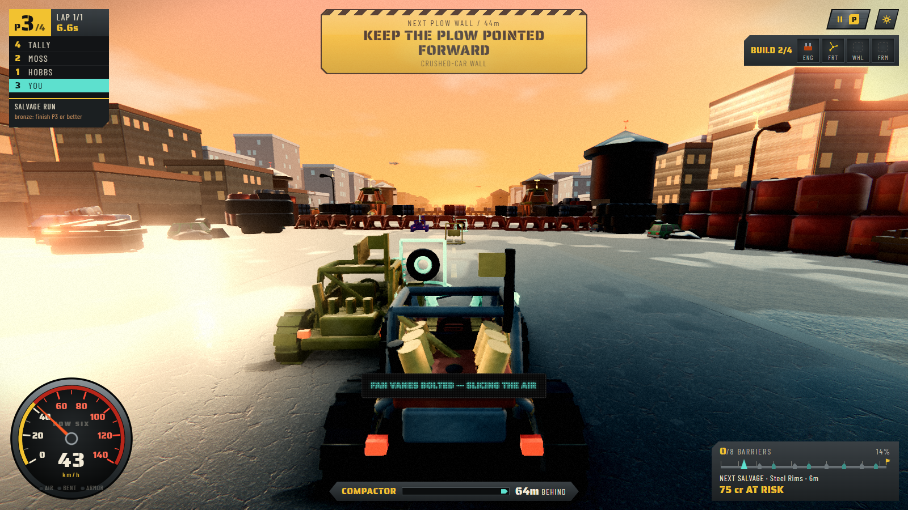
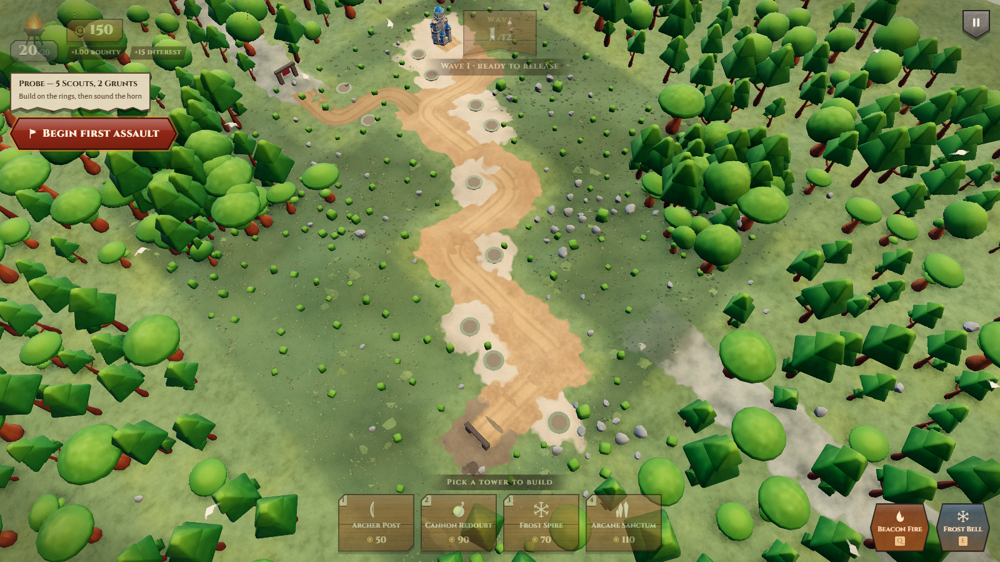
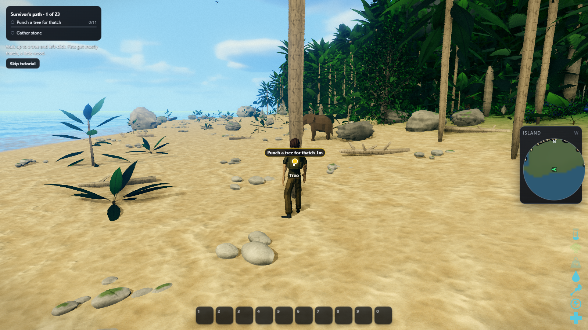

shared scenery draws and impostor bakes survive temporary membership changes without rebuilding shaders in play.

Root cause: temporary draw ownership freed reusable GPU resources, and nested loading boundaries allowed measurement before the complete scene mounted.

Engine seam: packages/assets/src/manifest.ts, packages/core/src/anim/crowdBatch.draw.ts, packages/core/src/buildings/GeneratedBuilding.draw.tsx, packages/core/src/instancing/StaticObjectModels.draw.tsx, packages/core/src/instancing/instanceChunks.draw.ts, packages/core/src/instancing/staticDrawPool.draw.ts, packages/core/src/instancing/staticObjectBatches.draw.ts, packages/core/src/lighting/shadowCasters.draw.ts and 22 more

### Added

- `importedPackNames` (`@jgengine/assets`): The original export names imported from `generated/packs`, including imports renamed locally.
- `importedPackNames` (`@jgengine/assets/manifest`): The original export names imported from `generated/packs`, including imports renamed locally.
- `LINGER_MS` (`@jgengine/core/run/lingering`): How long a resource whose last user left waits before it is freed. Also `Lingering`.
- `nextFrame` (`@jgengine/core/run/nextFrame.draw`): Resolves on the next animation frame, or a zero-delay timer in tests and SSR.
- `DECAL_CELL` (`@jgengine/core/scene/DecalRenderer.draw`): Edge in metres of the world cell one merged decal draw covers, so an unseen cell still culls whole.

### Changed

- Validation: the complete nine-game 1600x900 high moving-player gate measured zero shader links and framebuffers during play. Eight games failed the unchanged 16.7 ms frame limit while Wardogs used 26-31% GPU and whole-machine CPU reached 97%. The empty exception file and handling remain pending a clean all-game pass. An earlier quiet matched pair measured Harbor Heat 19.2 to 98.2 fps (102.5 to 12.5 ms p95) and Drift Foundry 62.8 to 113.4 fps (21.7 to 11.1 ms p95). Baseline Ember Command failed readiness twice and is not a matched comparison.
- 
- 
- 
- [Drift corridor movement proof](https://raw.githubusercontent.com/Noisemaker111/jgengine/pr-shots/pr-shots/agent/every-game-60fps-13/drift-foundry-sol-corridor.mp4): all arrival and movement checks passed; representative clip frames were inspected.

### Fixed

- shared scenery draws and impostor bakes survive temporary membership changes without rebuilding shaders in play.
- static props, buildings, character uploads, particles and the Drift Foundry HUD avoid repeated work while keeping their authored materials and detail.
- shadow and particle programs warm before play, and scatter loading holds readiness until the complete models mount.
- provisioning includes named asset-pack imports, and every game is measured moving at high quality with automatic quality changes disabled.
