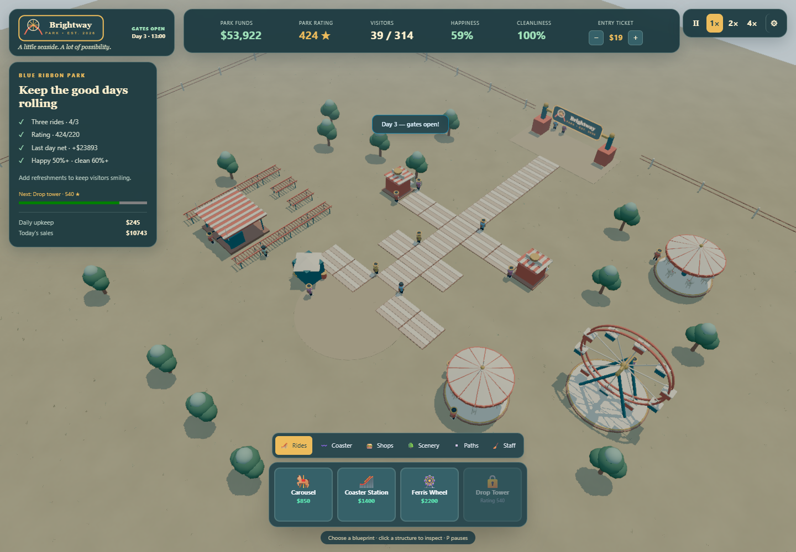
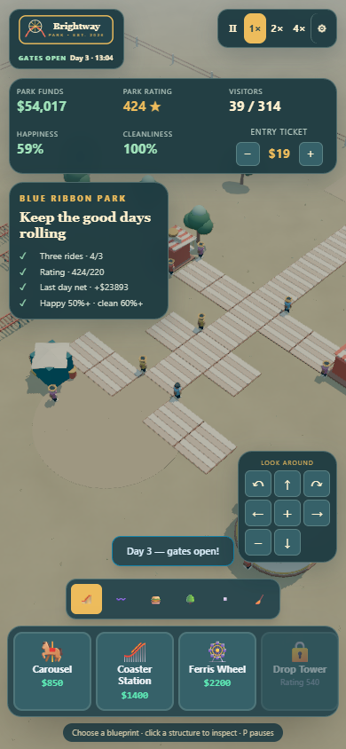
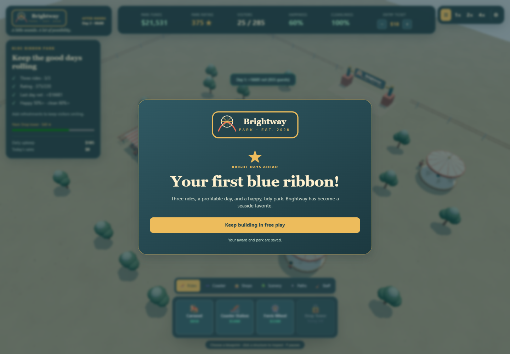

# Brightway Park — authored midway batch

Verified on 2026-09-29, port 4602, solo backend and an isolated browser profile.
The images below are captures of the running game. Desktop and mobile captures
use the production Vite build; the award capture uses the same game in dev mode.

## Observed controls and saves

- Opened a fresh park through the start button; the prior save was archived byte
  for byte. Built a janitor post and third carousel through catalog and canvas
  clicks, then ran at 4×. The blue ribbon appeared at midnight on day two, with
  a last-day net of $16,681. Reload retained the pending award; free play worked
  and its acknowledgement survived another reload.
- Selected, inspected and demolished a janitor post through world clicks. The
  $150 refund and upkeep decrease appeared in the HUD.
- P paused and resumed; 1 selected the carousel; X cancelled. Settings blocked
  gameplay shortcuts. Reduced motion and contrast checkboxes survived reload.
- At 390 × 844 and 320 × 568, document width matched viewport width. The small
  settings dialog scrolled to its close button. Holding the camera pad's arrow
  panned the actual camera; zoom changed its height. A mobile-layout catalog
  click placed a tree at (12, 32).
- The compiled game restored $53,547, 39 visitors and 53 placed objects after
  reload, with award and free-play state retained. Raising the ticket to $19
  survived reload. Fresh production navigation reported no failed HTTP requests
  or console errors. Windows WebGL emitted shader precision warnings during
  earlier dev sessions; the scene continued rendering.

## Reproduce checks

Run from `brightway-park/`: `bun run check-types`, `bun run test`, and
`bun run vite build`. Observed: 29 tests, 128 assertions, no failures. The build
warns about the existing large engine JavaScript chunk.

`bun run author-models` regenerates the original local meshes. See
[art credits](../ART-CREDITS.md) for retained third-party provenance.

Native diagnostics are optional: set `BRIGHTWAY_EVIDENCE_DIR` to the repository
home's task evidence directory and `VITE_PARK_EVIDENCE=1`, then run the dev script.
Commands, canvas coordinates, camera poses, keyboard events and runtime/network
failures append to `native-events.jsonl`. This endpoint is absent from builds.

## Remaining limits

Bankruptcy and closed-park command guards pass focused simulation tests with
forced debt; a three-day bankruptcy was not reached through native play. Coaster
track art still uses straight segments, and no guest in the starter park chose
the coaster during these captures, so the train's lap was verified in the ride
sim rather than seen moving in the browser. The next useful batch is guest ride
choice noise, connected track turns and economy tuning.

The published shell retains the initial menu's empty action map. Brightway routes
its discrete keyboard actions locally, honoring the shell's persisted binding
overrides and stopping duplicate dispatch. Touch camera buttons use the existing
RTS rig's DOM input boundary; no published packages were patched.
